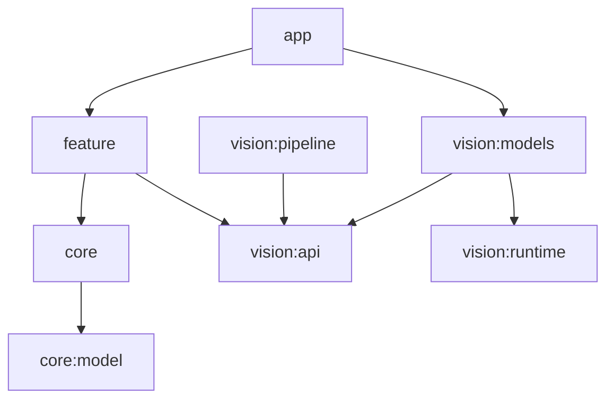

# Architecture

## Modules
```
:app                 entry, navigation, DI graph, foreground service registration
:core:common         Result/AppError, dispatchers, Clock, logging facade (no plate text)
:core:designsystem   tokens, M3 theme (dark default), components, motion tokens
:core:model          Observation, Track, PlateReading, QualityScore, RecognitionStatus…
:core:data           repositories (ObservationRepository, SessionRepository, SettingsRepository)
:core:database       Room DB, DAOs, FTS4, migrations, schema export
:core:storage        EvidenceFileStore (atomic writes, SHA-256), retention, export
:core:datastore      typed settings (DataStore)
:feature:monitor     live view, dashboard, MonitoringService (camera FGS)
:feature:records     timeline, search, filters
:feature:detail      observation detail, viewer, correction, export
:feature:incident    Incident Finder
:feature:settings    settings, calibration entry, storage, privacy, licenses
:feature:onboarding  first run, permissions, mounting/calibration wizard
:vision:api          VehicleDetector, PlateDetector, PlateOcr, Tracker, QualityEvaluator, CameraController
:vision:runtime      LiteRT interpreter management, delegates, tensor utils
:vision:pipeline     scheduler, preprocessing, tracking, motion, consensus, ranking, dedup, replay
:vision:models       concrete LiteRT adapters
:benchmark           macrobenchmark + inference microbenchmarks
build-logic          convention plugins
```
Dependency rule: `feature → core, vision:api`; only `:app` wires `vision:models`/`vision:runtime` via Hilt.



## Data flow
```
CameraX ImageAnalysis (KEEP_ONLY_LATEST, bounded executor)
 → FrameScheduler (adaptive, thermal-aware) → Preprocessor (YUV→RGB, ROI crop, buffer reuse)
 → VehicleDetector → Tracker → MotionClassifier
 → [confirmed + moving + in ROI] PlateDetector(vehicle crop) → deskew/contrast → PlateOcr
 → TurkishPlateParser → MultiFrameConsensus
 → QualityEvaluator → CandidateRanker → StillCaptureController (rate-limited)
 → TrackFinalizer → ObservationRepository (Room + EvidenceFileStore) → UI Flows
```

## Threading
- Analysis executor: single thread; stale frames dropped (KEEP_ONLY_LATEST).
- One bounded single-thread dispatcher per model; never main.
- Persistence on IO dispatcher; DB + files coordinated (files first via temp+rename, then DB row; orphan sweep).
- `SafeImageProxy` wrapper guarantees `close()` on every path (tested).

## State machines
- Session: `Idle → RequestingPermission → InitializingCamera → LoadingModels → Running ⇄ Degraded → Paused/Interrupted → Stopping → Idle`; `RecoverableError`, `FatalError`.
- Track: `Tentative → Confirmed → (Moving|Stationary) → CandidateCollecting → Finalizing → Persisted → Expired`.
- Recognition: `PENDING, HIGH_CONFIDENCE, NEEDS_REVIEW, UNREADABLE, NO_PLATE_VISIBLE, FAILED, USER_VERIFIED, USER_CORRECTED`.

Diagrams per state machine are added as each is implemented (Phases 6–7).
